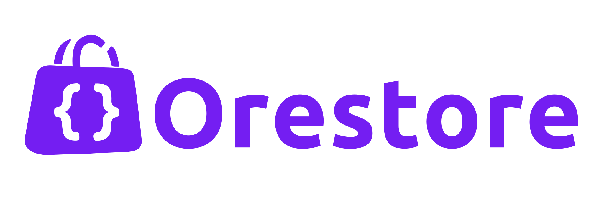

# Orestore



**The open-source, COD-first e-commerce platform for Algeria — built agentic-ready.**

[](https://t.me/codflow_dz)

Cash on Delivery on infrastructure you own. Self-host your entire commerce stack on one server (Node.js, PostgreSQL, Docker Compose) with zero transaction fees, connect to Algeria's delivery carriers, and optimize Meta ads for real deliveries instead of door refusals.

---

## Get Started

Choose your path:

<table>
<tr>
<td width="50%" valign="top">

### 🚀 **I want to run Orestore**

See it in action and deploy your own store.

**[→ See It in Action](#-see-it-in-action)**  
**[→ What works today](#-whats-included)**  
**[→ Quick setup guide](#-quick-setup)**  
**[→ Production deployment](./docs/DEPLOYMENT.md)**

</td>
<td width="50%" valign="top">

### 💻 **I want to contribute**

Build features or customize Orestore.

**[→ Contributing guide](./CONTRIBUTING.md)**  
**[→ Architecture overview](./docs/ARCHITECTURE.md)**  
**[→ AI agent instructions](./AGENTS.md)**

</td>
</tr>
</table>

---

## 🎥 See It in Action

Watch the step-by-step setup guide:

[](https://youtu.be/rJPCGQnDZ18)

**[▶️ Watch: Orestore Setup & Deployment Guide](https://youtu.be/rJPCGQnDZ18)**

---

## 🎯 The Problem Orestore Solves

E-commerce in Algeria is **95%+ Cash on Delivery (الدفع عند الاستلام)**. Western platforms like Shopify and local tools charge per-transaction fees and lock your data in their databases.

**Orestore is the first and only open-source COD e-commerce platform built for Algeria.**

| The Reality | Western/Local Platforms | Orestore |
| :--- | :--- | :--- |
| **Transaction fees eat margins** | 2–5% per order + monthly SaaS fees | **$0 transaction fees** — pay only for your own server |
| **Your data locked in their system** | Can't export, can't migrate, vendor lock-in | **You own everything** — PostgreSQL database, S3-compatible image storage, full control |
| **Hosting you don't control** | Your store lives on their servers | **Self-hosted** — one Docker Compose stack on your own server |
| **4+ carrier portals** | Juggle Yalidine, ZR, NOEST, EcoTrack separately | **Unified carrier API** — one integration for all carriers |
| **In-house drivers ignored** | No native driver dispatch or per-wilaya pay | **Built-in driver management** with compensation and cash settlement |
| **Ads optimize for form fills, not deliveries** | Meta Pixel fires on checkout submit (30–50% refuse at door) | **Meta CAPI fires at actual delivery** — optimize ads for real buyers |

**Run Orestore on your own server. No monthly fees. No transaction cuts. 100% open-source (Apache 2.0).**

---

## ✅ What's Included

Orestore v1.1.0 — here's what works today:

### Storefront (`cod-astro/theme01`)
- ✅ **Landing pages (`/lp/[slug]`)** — one-product marketing pages: stacked image story + COD form, no nav chrome
- ✅ Single-page COD checkout with live shipping calculation
- ✅ Home delivery **or** carrier stop-desk pickup selection
- ✅ Quantity-tier offers ("Buy 2 get 10% off", "Buy 3 free shipping")
- ✅ Order-verified product reviews (star ratings + Arabic/French text)
- ✅ Trilingual: Arabic (RTL), French, English
- ✅ Abandoned cart telemetry for recovery campaigns
- ✅ Optional WhatsApp phone verification at checkout ([DZVerify](https://dzverify.com), off by default)
- ✅ Optional Cloudflare Turnstile bot protection on the checkout form ([Turnstile](https://www.cloudflare.com/products/turnstile/), off by default)
- ✅ Legal pages (`/pages/[slug]`) — Terms, Privacy, Refund/Return, Shipping (pre-seeded, merchant-editable) and any custom page, with a checkout consent line linking to them
- ✅ Merchant-configurable order form — require or hide the address, notes and email, turn a delivery option off, and add up to 5 questions of your own (enforced server-side, not just hidden)

### Merchant Dashboard (`cod-client-astro`)
- ✅ Order management with full COD lifecycle tracking
- ✅ Product catalog with multi-attribute variants (size, color, SKU) and image uploads
- ✅ Inventory tracking with low-stock alerts and adjustment history
- ✅ Promotion engine (Buy X Get Y, free shipping rules)
- ✅ **Landing page studio** — two-sidebar builder (image stack + spacing), product-picker-first creation, publish flow, live link copy
- ✅ **Landing page comparison** — per-product A/B table (views, orders, CVR, revenue) to pick winning creatives
- ✅ Review moderation (approve, reject, delete)
- ✅ Customer CRM with profiles, order history, groups, and tags
- ✅ Delivery: in-house drivers, per-wilaya compensation, cash settlement
- ✅ Carrier company management (credentials, stop-desk sync, reconciliation)
- ✅ Team RBAC with granular permission scopes and API keys
- ✅ Meta Pixel & CAPI configuration UI
- ✅ Abandoned order recovery
- ✅ MCP agent connection management
- ✅ Legal pages editor — TipTap rich-text, per-locale (store's own language first), one-click reset to the current Orestore template, and the business-details form templates render from
- ✅ Trilingual: Arabic (RTL), French, English

### Delivery Engine
- ✅ 4 Algerian carriers + EcoTrack (80+ couriers behind one API)
- ✅ One-click shipment creation with printable labels
- ✅ Real-time webhook tracking (Yalidine, ZR Express with HMAC verification)
- ✅ Carrier delivery-zone name sync — dispatches carry the carrier's exact wilaya/commune spellings (Yalidine)
- ✅ Dispatch-time delivery-type switching (home ⇄ stop desk) with wilaya-scoped desk picking
- ✅ Webhook event log with per-event outcomes (applied / ignored / unmapped / error) per carrier
- ✅ Stop-desk catalog syncing across 58 wilayas
- ✅ In-house driver fleet management
- ✅ Per-wilaya driver compensation with cash settlement
- ✅ Partial returns with automatic inventory restock

### Growth Engine
- ✅ Per-channel trackers: Meta, TikTok, Snapchat, GA4 and Google Ads, with identifier format checks, a test event per platform and a diagnostics list
- ✅ Browser events (page view, product view, add to cart, checkout start, conversion) plus server-side conversions for Meta, TikTok, Snapchat and GA4, deduplicated by the order id
- ✅ UTMs and ad click ids kept for the session and stored on the order (the campaign also reaches the Aventy payload)
- ✅ Optional per-channel consent banner: no tracker loads and no server-side conversion is sent before the visitor accepts
- ✅ Meta Pixel (browser) + Conversions API (server) dual setup with event deduplication
- ✅ Merchant-chosen conversion event: `Lead` at order placement or `Purchase` at confirmed delivery
- ✅ Test Mode toggle routes CAPI events to Meta's test stream (`test_event_code`)
- ✅ Graph API v26.0 with 7-day attribution window compliance
- ✅ PII hashed per Meta spec (phone, names, city, zip, country, external_id); IP, User-Agent, `fbp`, `fbc` sent unhashed as required
- ✅ `fbp` and `fbc` attribution preservation
- ✅ Durable retry through a PostgreSQL job queue (network, 429 and 5xx, exponential backoff; survives restarts)
- ✅ CAPI event audit log (`capi_event_log`) for every send attempt

### AI & Agentic (MCP)
- ✅ RFC 9728 OAuth Protected Resource Discovery with dynamic client registration
- ✅ OAuth login relay from the dashboard (login-ticket bridge)
- ✅ 15 RBAC-gated tool sets (orders, products, stock, offers, landing pages, reviews, customers, drivers, etc.)
- ✅ Stateless elicitation with HMAC-sealed confirmation state
- ✅ Compatible with Claude, Cursor, ChatGPT, LibreChat

### Backend (`cod-server`)
- ✅ Hono 4 on Node.js
- ✅ Drizzle ORM + PostgreSQL, every store isolated by Row-Level Security
- ✅ Indexed hot paths, one transaction per request with locked stock checks, keyset pagination
- ✅ Auto-generated OpenAPI 3.1 spec at `/api/docs`
- ✅ Standardized error envelopes with semantic codes
- ✅ Image storage on S3-compatible SeaweedFS, checked and converted to WebP on upload, resized on request
- ✅ Redis-backed rate limiting (MCP calls, WhatsApp OTP)
- ✅ Background jobs on a PostgreSQL job queue

**Known Limitations:**  
See [`docs/KNOWN_LIMITATIONS.md`](./docs/KNOWN_LIMITATIONS.md) for honest coverage of incomplete features and platform constraints.

---

## ⚡ Quick Setup

Run the whole stack locally with Docker Compose:

> 🤖 **Using an AI Coding Assistant?** Tell your agent: *"Set up Orestore"* and it will follow the [`codflow-setup` skill](./.agents/skills/codflow-setup/SKILL.md).

### Prerequisites
- **Docker** with Docker Compose
- **Node.js 22.12+** and npm (for development and tests)

### 1. Clone & Start
```bash
git clone https://github.com/bighadj22/codflow.git
cd codflow
docker compose up --build
```

Then open:

- http://shop1.localhost:8090 and http://shop2.localhost:8090 — two demo channels served by the same storefront
- http://app.localhost:8090 — the merchant dashboard (`admin@example.com` / `admin-dev-password`)

The stack runs PostgreSQL, Redis, SeaweedFS (image storage), the API, the storefront, the dashboard and Caddy.

### 2. Develop and Test
```bash
npm ci                          # at the repo root — installs every workspace
docker compose up -d db         # PostgreSQL, needed by the cod-server tests

cd cod-server && npm run typecheck && npm test
cd cod-server && npm run db:setup   # migrate + demo channels + legal pages (DATABASE_URL)
cd cod-server && npm run dev        # API on :8787
cd cod-client-astro && npm run dev  # dashboard on :4321
```

The dashboard and the storefront both default to port 4321 — run one of them with `--port 4322`. Each package's environment is described in its `.env.example`; sign-up is disabled, so seed a dashboard admin with `cd cod-client-astro && DATABASE_URL=… npm run seed:admin -- --merchant=<id>`.

Images are stored in S3-compatible storage behind cod-server — see the [image guide](./cod-server/src/endpoints/images/README.md). Merchants connect their own domains from the dashboard's Domains screen; Caddy issues their certificates on demand — see [`docs/CUSTOM-DOMAINS.md`](./docs/CUSTOM-DOMAINS.md).

---

## 🚢 Production Deployment

See [`docs/DEPLOYMENT.md`](./docs/DEPLOYMENT.md) for installing Orestore on a server and [`docs/CONFIGURATION.md`](./docs/CONFIGURATION.md) for every setting.

---

## 🏗️ Architecture

```
                          ┌──────────────────────────────────────────┐
                          │              cod-shared                  │
                          │ Drizzle schema • RBAC scopes • queries   │
                          └───────────────┬──────────────────────────┘
                                          │ relative imports
               ┌──────────────────────────┼──────────────────────────┐
               │                          │                          │
       ┌───────▼───────┐         ┌────────▼────────┐        ┌────────▼────────┐
       │  Storefront   │         │     Backend     │        │   Dashboard     │
       │  cod-astro    │──/store─▶  cod-server     │◀──/api─│ cod-client-astro│
       │  (Astro 7)    │  API    │  (Hono + jobs)  │  API   │  (Astro 7)      │
       └───────┬───────┘         └───┬─────┬───────┘        └─────────────────┘
               │                     │     │
               │               /webhooks   │ conversion jobs
               │              carrier calls│
               │                     │     └─────────▶ Meta Conversions API
               │                     │                 (Purchase @ delivered)
               │                     │
               │              ┌──────▼─────┐
               │              │ Carriers    │   Yalidine • ZR Express  (webhooks)
               │              │  APIs       │   NOEST • EcoTrack       (tracking pull)
               │              └─────────────┘
               │
               │        /images (S3)      /mcp (AI agents, OAuth-scoped)
               └──────────────────────────────────────────────────────▶
```

**Tech Stack:**
- **Storefront:** Astro 7, Tailwind CSS v4 → Node.js
- **Backend:** Hono 4, Drizzle ORM, PostgreSQL job queue → Node.js + PostgreSQL + Redis + SeaweedFS (S3)
- **Dashboard:** Astro 7 (prerendered static + Better Auth server routes) → Node.js + PostgreSQL + Redis
- **Edge:** Caddy (on-demand TLS for merchant domains), everything in Docker Compose
- **Shared:** Drizzle schema, RBAC scopes, error codes

**More detail:** [`docs/ARCHITECTURE.md`](./docs/ARCHITECTURE.md)

---

## 🧪 Testing

```bash
# Backend tests (handlers, jobs, OpenAPI, MCP) — needs `docker compose up -d db`
cd cod-server && npm test

# Dashboard tests (feature models, i18n guards, API seam)
cd cod-client-astro && npm test

# Storefront tests (property-based, cart calculations)
cd cod-astro/theme01 && npm test

# TypeScript verification
cd cod-server && npm run typecheck
cd cod-client-astro && npm run typecheck
```

CI runs typecheck + tests for cod-server and cod-client-astro, plus
astro check + tests for theme01.

---

## 📚 Documentation

| Document | Purpose |
| :--- | :--- |
| **[docs/DEPLOYMENT.md](./docs/DEPLOYMENT.md)** | Production install on your own server |
| **[docs/ARCHITECTURE.md](./docs/ARCHITECTURE.md)** | System map and data flows |
| **[docs/CONFIGURATION.md](./docs/CONFIGURATION.md)** | All environment variables and configs |
| **[docs/KNOWN_LIMITATIONS.md](./docs/KNOWN_LIMITATIONS.md)** | Incomplete features and platform constraints |
| **[docs/SHOPPING-CART.md](./docs/SHOPPING-CART.md)** | Shopping cart, checkout page, free-delivery threshold |
| **[docs/LEGAL-PAGES.md](./docs/LEGAL-PAGES.md)** | Terms, Privacy, Refund and Shipping pages — pre-seeded, merchant-editable |
| **[docs/WHATSAPP-OTP-VERIFICATION.md](./docs/WHATSAPP-OTP-VERIFICATION.md)** | WhatsApp OTP verification feature |
| **[docs/TURNSTILE.md](./docs/TURNSTILE.md)** | Cloudflare Turnstile checkout bot protection |
| **[docs/CHECKOUT-FORM.md](./docs/CHECKOUT-FORM.md)** | Merchant-configurable storefront order form and custom questions |
| **[docs/EMAIL-SENDING.md](./docs/EMAIL-SENDING.md)** | Transactional email feature (Sendili) |
| **[CONTRIBUTING.md](./CONTRIBUTING.md)** | Development standards and PR workflow |
| **[AGENTS.md](./AGENTS.md)** | Repository instructions for AI coding assistants |
### 🎬 Video Tutorial

**[▶️ Watch: How to edit your Orestore theme](https://youtu.be/zZGWdEeUXVo)**

---

## 🗺️ Roadmap

### Planned

- 📈 **Deeper dashboard analytics** — revenue, delivery-rate, and return-rate trends
- 📦 **More Themes** — Additional storefront themes beyond `theme01`
- 📘 **Theme Editing Guides** — Comprehensive guides for customizing and creating themes
- ☁️ **Orestore Cloud** — One-click deployment from dashboard for agencies to resell Orestore
- 📧 **Email order notifications & admin alerts** — extend the Sendili integration beyond transactional mail

### Recently Shipped

- ✅ **Legal Pages** — Terms, Privacy, Refund/Return, Shipping pre-seeded per store from Algeria-COD-grounded templates, merchant-editable with the dashboard's TipTap editor, and any custom page on the same rails
- ✅ **Yalidine Hardening** — full 36-status webhook mapping (live-verified return flows), HMAC-SHA256 signature verification, per-carrier delivery-zone name sync, dispatch-time delivery-type switching, and a webhook events log for every webhook-capable carrier
- ✅ **Landing Pages** — one-product marketing pages (image stack + COD order form) with the Studio builder, per-link stats, A/B comparison, order attribution, and 7 MCP tools
- ✅ **Astro Dashboard** — the merchant dashboard now runs on Astro (was Next.js)
- ✅ **WhatsApp OTP Verification** — [DZVerify.com](https://dzverify.com) phone verification at checkout
- ✅ **Cloudflare Turnstile** — optional per-store bot protection on the checkout form (off by default)
- ✅ **EcoTrack Integration** — 80+ Algerian couriers behind one API
- ✅ **Transactional Email (Sendili)** — [Sendili.com](https://sendili.com) powers team-invite emails and password-reset emails; merchants configure their API key and verified sending domain in Settings → Email Sending

---

## 🤝 Contributing

We welcome contributions from developers across Algeria and the global open-source community.

1. Fork the repo and create a feature branch (`feat/amazing-feature`)
2. Maintain code-verified claims and test coverage
3. Keep credentials and live API keys out of commits
4. Submit a PR referencing the related issue

See **[CONTRIBUTING.md](./CONTRIBUTING.md)** for detailed guidelines.

---

## 📄 License

**Apache License 2.0** — 100% free and open-source.  
See [`LICENSE`](./LICENSE) and [`NOTICE`](./NOTICE) for details.

---

## 🔗 Resources

- **Repository:** [github.com/bighadj22/codflow](https://github.com/bighadj22/codflow)
- **Video Setup Guide:** [Watch on YouTube](https://youtu.be/rJPCGQnDZ18)
- **Changelog:** [CHANGELOG.md](./CHANGELOG.md)
- **Security Policy:** [SECURITY.md](./SECURITY.md)

---

**Version:** v1.1.0 — Self-hosted on Node.js + PostgreSQL.  
Built with ❤️ for Algerian e-commerce.
